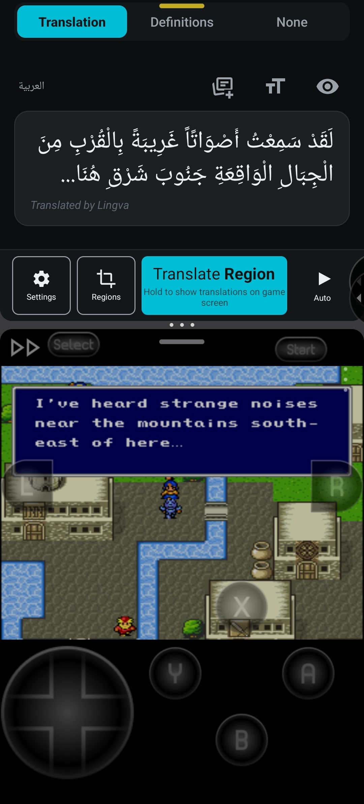

# Tashkeel Gamer

An Android screen translator for games, visual novels, manga, and other on-screen text.

**Tashkeel Gamer** is a community fork of [PlayTranslate](https://github.com/dominostars/playtranslate). It adds Arabic tashkeel (diacritical marks) to Arabic translations using a local [Text2Tashkeel](https://github.com/TigreGotico/text2tashkeel) service.

[](https://www.android.com/)
[](LICENSE)

## Screenshots

### Dual-screen Final Fantasy IV gameplay



## Features

- **Arabic Tashkeel:** Adds Arabic diacritical marks to translated Arabic text through a local Text2Tashkeel server.
- **One-tap Translation:** Capture game text and translate it with one tap.
- **Auto Translation Mode:** Automatically translates dialogue as it changes.
- **Word Lookup:** Look up individual words using the floating lens.
- **Dual Screen & Split Screen:** Use the translator alongside games on dual-display devices or in Android split-screen.
- **Capture Regions:** Select the dialogue box, subtitles, or another screen area.
- **Text-to-Speech:** Listen to translated text.
- **Anki Export:** Save sentences and vocabulary for language learning.
- **Yomitan Integration:** Use compatible dictionaries and lookup features.
- **Camera Translation:** Translate text captured by the camera.
- **Text History:** Keep a record of captured sentences.

Some inherited PlayTranslate features may depend on device compatibility and app settings.
## Installing the Android App

1. Open the [Tashkeel Gamer GitHub Actions page](https://github.com/existentialjuice/tashkeel-gamer/actions).
2. Open the latest successful Android debug build.
3. Download the `tashkeel-gamer-debug-apk` artifact.
4. Extract the downloaded artifact and install the APK on your Android device.
5. If Android asks, allow your browser or file manager to install unknown apps.
6. Open Tashkeel Gamer and complete the permission setup.

## Setting Up the Arabic Tashkeel Server

The Arabic tashkeel feature uses a separate Python server running locally on the same Android device as Tashkeel Gamer.

You will need [Termux](https://github.com/termux/termux-app).

### 1. Install the required packages

```bash
pkg update -y
pkg install python curl -y
python -m pip install flask
python -m pip install --pre text2tashkeel

```

### 2. Download the Tashkeel server

```bash
curl -fL "https://raw.githubusercontent.com/existentialjuice/tashkeel-gamer/main/server/tashkeel_server.py" -o ~/tashkeel_server.py
```

### 3. Create a startup command

```bash
mkdir -p ~/bin
cat > ~/bin/starttashkeel <<'EOF'
#!/data/data/com.termux/files/usr/bin/bash
python "$HOME/tashkeel_server.py"
EOF
chmod +x ~/bin/starttashkeel
```

### 4. Start the server

Whenever you want to use Arabic tashkeel, open Termux and run:

```bash
~/bin/starttashkeel
```

Keep Termux running while using Tashkeel Gamer. The server listens only on the device's localhost address (`127.0.0.1:8765`), so it is intended for the app on the same device.

### Troubleshooting

- If Arabic translations appear without tashkeel, make sure the Termux server is running.
- If Termux reports that `text2tashkeel` is missing, repeat the package installation commands above.
- If the server stops, run `~/bin/starttashkeel` again.

## Project Attribution

Tashkeel Gamer is a community fork of PlayTranslate. It retains the upstream project's translation engine and inherited features while adding a local Arabic tashkeel step. Please see the Credits and License sections below for upstream acknowledgements and licensing.

## Supported Languages

The inherited PlayTranslate translation engine supports **26 game languages** (the text it can read off the screen) into **59 translation languages** (the language shown to you). Both tables are sorted by total worldwide speakers.

### Game languages (read from the screen)

| Language              | Native name      | Code     |
|-----------------------|------------------|----------|
| English               | English          | en       |
| Chinese (Simplified)  | 简体中文          | zh       |
| Chinese (Traditional) | 繁體中文          | zh-Hant  |
| Hindi                 | हिन्दी            | hi       |
| Spanish               | Español          | es       |
| Arabic                | العربية          | ar       |
| French                | Français         | fr       |
| Portuguese            | Português        | pt       |
| Russian               | Русский          | ru       |
| Indonesian            | Bahasa Indonesia | id       |
| German                | Deutsch          | de       |
| Japanese              | 日本語           | ja       |
| Turkish               | Türkçe           | tr       |
| Vietnamese            | Tiếng Việt       | vi       |
| Korean                | 한국어           | ko       |
| Italian               | Italiano         | it       |
| Thai                  | ไทย              | th       |
| Dutch                 | Nederlands       | nl       |
| Romanian              | Română           | ro       |
| Hungarian             | Magyar           | hu       |
| Swedish               | Svenska          | sv       |
| Catalan               | Català           | ca       |
| Danish                | Dansk            | da       |
| Finnish               | Suomi            | fi       |
| Norwegian             | Norsk            | no       |
| Polish                | Polski           | pl       |

### Translation languages (translated for you)

| Language       | Native name        | Code |
|----------------|--------------------|------|
| English        | English            | en   |
| Chinese        | 中文               | zh   |
| Hindi          | हिन्दी              | hi   |
| Spanish        | Español            | es   |
| Arabic         | العربية             | ar   |
| French         | Français           | fr   |
| Bengali        | বাংলা              | bn   |
| Portuguese     | Português          | pt   |
| Russian        | Русский            | ru   |
| Urdu           | اردو               | ur   |
| Indonesian     | Bahasa Indonesia   | id   |
| Swahili        | Kiswahili          | sw   |
| German         | Deutsch            | de   |
| Japanese       | 日本語             | ja   |
| Marathi        | मराठी              | mr   |
| Telugu         | తెలుగు              | te   |
| Turkish        | Türkçe             | tr   |
| Vietnamese     | Tiếng Việt         | vi   |
| Korean         | 한국어             | ko   |
| Tamil          | தமிழ்              | ta   |
| Persian        | فارسی              | fa   |
| Italian        | Italiano           | it   |
| Thai           | ไทย                | th   |
| Gujarati       | ગુજરાતી             | gu   |
| Polish         | Polski             | pl   |
| Ukrainian      | Українська         | uk   |
| Tagalog        | Tagalog            | tl   |
| Malay          | Bahasa Melayu      | ms   |
| Kannada        | ಕನ್ನಡ              | kn   |
| Dutch          | Nederlands         | nl   |
| Romanian       | Română             | ro   |
| Hungarian      | Magyar             | hu   |
| Greek          | Ελληνικά           | el   |
| Czech          | Čeština            | cs   |
| Swedish        | Svenska            | sv   |
| Belarusian     | Беларуская         | be   |
| Hebrew         | עברית              | he   |
| Bulgarian      | Български          | bg   |
| Catalan        | Català             | ca   |
| Slovak         | Slovenčina         | sk   |
| Haitian Creole | Kreyòl Ayisyen     | ht   |
| Croatian       | Hrvatski           | hr   |
| Danish         | Dansk              | da   |
| Finnish        | Suomi              | fi   |
| Norwegian      | Norsk              | no   |
| Albanian       | Shqip              | sq   |
| Galician       | Galego             | gl   |
| Slovenian      | Slovenščina        | sl   |
| Lithuanian     | Lietuvių           | lt   |
| Latvian       | Latviešu           | lv   |
| Afrikaans      | Afrikaans          | af   |
| Macedonian     | Македонски         | mk   |
| Estonian       | Eesti              | et   |
| Georgian       | ქართული            | ka   |
| Welsh          | Cymraeg            | cy   |
| Maltese        | Malti              | mt   |
| Icelandic      | Íslenska           | is   |
| Irish          | Gaeilge            | ga   |
| Esperanto      | Esperanto          | eo   |

## Optional: Online Translation Backends

By default, translation uses [Lingva](https://github.com/thedaviddelta/lingva-translate) with ML Kit as an offline fallback. For higher quality translations, you can add any of the following under **Settings → Translation services**. Add as many as you like — each service is its own entry in the list, so you can keep several configured and reorder them to pick which one translates first:

- **DeepL**: free tier at [deepl.com/en/pro#developer](https://www.deepl.com/en/pro#developer)
- **OpenAI**: [platform.openai.com](https://platform.openai.com/api-keys) — pick a model at runtime
- **Gemini**: [aistudio.google.com](https://aistudio.google.com/app/apikey) — pick a model at runtime
- **DeepSeek**: [platform.deepseek.com](https://platform.deepseek.com/api_keys) — pick a model at runtime
- **Mistral**: [console.mistral.ai](https://console.mistral.ai/api-keys) — pick a model at runtime
- **Groq**: [console.groq.com](https://console.groq.com/keys) — pick a model at runtime
- **OpenRouter**: [openrouter.ai](https://openrouter.ai/keys) — pick a model at runtime
- **Claude**: [platform.claude.com](https://platform.claude.com/settings/keys) — pick a model at runtime
- **Bilibili Index-Translate**: [index-translate.bilibili.com](https://github.com/bilibili/Index-Translate) — free, no API key needed. May be temporary
- **Custom**: any other OpenAI-compatible endpoint — point it at your own base URL

## Optional: Anki Flashcards

Install [AnkiDroid](https://play.google.com/store/apps/details?id=com.ichi2.anki) and grant PlayTranslate access in Settings to export cards directly to your decks.

## Credits

### Libraries and services

- [ML Kit](https://developers.google.com/ml-kit): on-device OCR and translation
- [Sudachi](https://github.com/WorksApplications/Sudachi): Japanese morphological analysis (Apache 2.0)
- [Yomitan](https://github.com/yomidevs/yomitan): Japanese deinflection rules and their test suite, ported from the browser extension (GPL-3.0)
- [HanLP](https://github.com/hankcs/HanLP): Chinese word segmentation
- [KOMORAN](https://github.com/shineware/KOMORAN): Korean morphological analysis
- [Snowball stemmers](https://snowballstem.org/) via [Apache Lucene](https://lucene.apache.org/): Latin/European stemming
- [Lingva](https://github.com/thedaviddelta/lingva-translate): online translation
- [AnkiDroid](https://github.com/ankidroid/Anki-Android): flashcard integration
- [MNN](https://github.com/alibaba/MNN): on-device LLM and OCR inference engine (Apache 2.0)
- [PaddleOCR](https://github.com/PaddlePaddle/PaddleOCR): on-device OCR from the bundled PP-OCRv6 text detector and unified recognizer, plus optional per-script recognizers (Apache 2.0)
- [OpenCV](https://opencv.org/): image processing for OCR (DBNet contour postprocessing, crop rectification) and for the camera tool's planar tracker (ORB features, pyramidal Lucas-Kanade flow, RANSAC homography fitting) (Apache 2.0)
- [Silero VAD](https://github.com/snakers4/silero-vad): voice-activity detection for the game-audio trimmer, bundled as a converted MNN model (MIT)
- [OpenCC4j](https://github.com/houbb/opencc4j): Simplified/Traditional Chinese conversion (Apache 2.0)
- [slimt](https://github.com/jerinphilip/slimt): tiny [Marian](https://marian-nmt.github.io/)-based NMT engine that runs the Bergamot offline models (GPL-2.0-or-later, with MPL-2.0 Marian components)
- [OkHttp](https://square.github.io/okhttp/): HTTP client for online translation and downloads (Apache 2.0)
- [kotlinx.serialization](https://github.com/Kotlin/kotlinx.serialization): JSON (de)serialization for the translation backends and data models (Apache 2.0)
- [Gson](https://github.com/google/gson): streaming JSON parsing for Yomitan dictionary banks (Apache 2.0)
- [CameraX](https://developer.android.com/training/camerax): camera preview and analysis frames for the camera tool (Apache 2.0)
- [Material Components for Android](https://github.com/material-components/material-components-android) and [Material Symbols](https://fonts.google.com/icons): UI components, and icons traced from the Outlined symbol set (Apache 2.0)

### Adapted from other projects

Work we reimplemented rather than linked. No source was copied verbatim.

- [offline-translator](https://github.com/DavidVentura/offline-translator) (David Ventura): its `translator-rs` planar tracking engine is the design reference for the camera tool's keyframe-OCR tracker. We took the split between optical flow that sustains correspondences and descriptor re-matching that corrects drift, the Idle/Locked/Lost lifecycle with inlier hysteresis, the anchor cache that re-locks a previously seen scene without re-running OCR, and several tuned thresholds. Independently reimplemented in Kotlin over OpenCV, without the reference's IMU prior and with a smoothing filter of our own (offline-translator GPL 3.0; `translator-rs` MIT)
- [PyThaiNLP](https://github.com/PyThaiNLP/pythainlp): Thai word segmentation, a faithful Kotlin port of its `newmm` maximal-matcher, run over a word list that includes its CC0 list (Apache 2.0)
- [docTR](https://github.com/mindee/doctr) and [EasyOCR](https://github.com/JaidedAI/EasyOCR): line-grouping logic adapted for OCR word-box assembly, following docTR's recognize-then-group architecture with thresholds modelled on docTR `_resolve_lines` and EasyOCR `group_text_box` (Apache 2.0)
- [Yomitan](https://github.com/yomidevs/yomitan): the dictionary format our importer and styled renderer target — structured-content glossaries, per-dictionary CSS scoping, and media references. `YomitanContentHtml` is an independent Kotlin implementation of the format's tag and inline-style whitelists, following Yomitan's render-side sanitisation model (GPL 3.0)

### (Optional) Downloadable Offline Models

- Gemma 4 E2B (Google): downloadable as an optional offline pack, MNN conversion by [taobao-mnn](https://huggingface.co/taobao-mnn/gemma-4-E2B-it-MNN) (Apache 2.0)
- Hy-MT2 1.8B (Tencent): translation-specialised model, downloadable as an optional offline pack, MNN conversion by [@starsharp06sharp](https://huggingface.co/starsharp06sharp/Hy-MT2-1.8B-MNN) (Apache 2.0)
- Qwen 3.5 2B (Alibaba): downloadable as an optional offline pack, MNN conversion by [taobao-mnn](https://huggingface.co/taobao-mnn/Qwen3.5-2B-MNN) (Apache 2.0)
- Retired packs, still recognised while installed: Qwen 2.5 1.5B Instruct (Apache 2.0) and Hunyuan-MT 1.5 1.8B (Tencent HY Community License; not available in the EU, UK, or South Korea)
- [PaddleOCR PP-OCRv5+v6 recognizers](https://github.com/PaddlePaddle/PaddleOCR): optional per-script OCR recognizer packs for additional scripts (e.g. Korean, Arabic, Cyrillic, Thai), downloadable per source language (Apache 2.0)
- [Meiki](https://github.com/rtr46/meikiocr): high-accuracy Japanese OCR model (D-FINE), downloadable as an optional offline pack (LGPL 3.0)
- [MangaOCR](https://huggingface.co/jzhang533/manga-ocr-base-2025): Japanese OCR refinement for stylized and vertical text, downloadable as an optional offline pack. `manga-ocr-base-2025` by jzhang533, based on [manga-ocr](https://github.com/kha-white/manga-ocr) by kha-white (Maciej Budyś), both Apache 2.0, converted to fp16 MNN for on-device use. The manga-ocr model family is trained using the [Manga109-s](https://manga109.github.io/manga109-project-website/en/index.html) dataset, whose use is acknowledged per its terms
- [Firefox Translations (Bergamot)](https://github.com/mozilla/translations): Mozilla's offline NMT model pairs, downloadable for offline translation (CC BY-SA 4.0)

### Linguistic data

- [JMdict](https://www.edrdg.org/jmdict/j_jmdict.html), [KANJIDIC2](https://www.edrdg.org/kanjidic/kanjidic2.html), and [JMnedict](https://www.edrdg.org/enamdict/enamdict_doc.html): Japanese dictionary, kanji, and proper-name data (EDRDG licence; JMnedict offered as an optional in-app [Yomitan](https://github.com/yomidevs/jmdict-yomitan) download)
- [CC-CEDICT](https://cc-cedict.org/wiki/): Chinese-English dictionary (CC BY-SA 4.0)
- [CFDICT](https://chinese.gratis/cfdict.php): Chinese-French dictionary, used for French-target glosses (CC BY-SA 3.0)
- [HanDeDict](https://handedict.zydeo.net/): Chinese-German dictionary, used for German-target glosses (CC BY-SA 2.0 DE)
- [Unihan](https://www.unicode.org/reports/tr38/) (Unicode Han Database): Chinese character readings, used to choose which reading leads when a character has several (© Unicode, Inc.; Unicode License v3)
- [Wiktionary](https://en.wiktionary.org/) via [kaikki.org](https://kaikki.org/): multilingual dictionary entries (CC BY-SA)
- [Tatoeba](https://tatoeba.org/): example sentences (CC BY 2.0)
- [PanLex](https://panlex.org/): multilingual translation pairs (CC0)
- [wordfreq](https://github.com/rspeer/wordfreq): word frequency data
- [Camel Morph MSA](https://github.com/CAMeL-Lab/camel_morph): Arabic morphology, used to map inflected and broken-plural surface forms to dictionary lemmas (© CAMeL Lab, NYU Abu Dhabi; CC BY 4.0, modified)
- [Arramooz](https://github.com/linuxscout/arramooz): Arabic morphological dictionary (© Taha Zerrouki; GPL 3.0)
- [Morfologik](https://github.com/morfologik/morfologik-stemming) / PoliMorf: Polish morphology, used to map inflected surface forms to dictionary lemmas (© Marcin Miłkowski; BSD-2-Clause)
- [SudachiDict](https://github.com/WorksApplications/SudachiDict): Japanese tokenizer dictionary bundled for Sudachi, including [UniDic](https://clrd.ninjal.ac.jp/unidic/) (© NINJAL) and part of [mecab-ipadic-NEologd](https://github.com/neologd/mecab-ipadic-neologd) (Apache 2.0)
- [Jiten](https://jiten.moe/): Japanese frequency data, offered as an optional in-app Yomitan dictionary download (CC BY-SA 4.0)
- [Wikimedia Commons](https://commons.wikimedia.org/): pronunciation audio for word playback and Anki cards, fetched on demand. Each clip carries its own author and license (typically CC BY / CC BY-SA / public domain), shown as a credit that travels onto exported cards

## License

[GPL 3.0](LICENSE)
